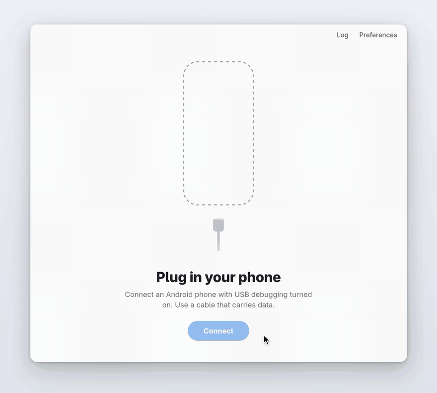

# Gnirehtet GUI: reverse tethering for Android over USB

[](https://github.com/sawongam/gnirehtet-gui/releases/latest)
[](LICENSE)

Use your computer's internet connection on your Android phone through a USB
cable. No root, no Wi-Fi hotspot, nothing to configure on the phone. Runs on
Linux, Windows and macOS.

This is a desktop app for [gnirehtet](https://github.com/Genymobile/gnirehtet),
the reverse tethering tool by Genymobile. It is an independent project, not
affiliated with or endorsed by Genymobile. Plug the phone in, click **Connect**,
accept the VPN prompt on the phone, and it is online. The app handles the parts
of gnirehtet that usually happen in a terminal: starting the relay, installing
the Android client, setting up the adb tunnel, and cleaning up when you
disconnect or unplug.

<p align="center">
  <picture>
    <source media="(prefers-color-scheme: dark)" srcset="docs/screenshots/flow-dark.gif">
    
  </picture>
</p>

It uses the unmodified gnirehtet **v2.5.1** relay and Android client; this project
adds the desktop interface and the process management around them.

The upstream relay source is also vendored in `crates/gnirehtet-relay`, because
upstream ships no prebuilt relay for macOS or ARM. On those platforms the build
compiles it from that copy instead of downloading it.

## When it's useful

- Your desktop is on wired Ethernet and there's no Wi-Fi for the phone.
- The phone has no SIM, no data plan, or weak signal where you are.
- You're testing an app on a real device and want it on the same network as
  your computer, including its VPN.
- You want to save mobile data while the phone is plugged in anyway.

## Features

- Detects connected phones and explains what to do when one is unauthorized,
  offline or not accessible (Linux udev permissions).
- Installs the gnirehtet client on the phone automatically on first use.
- Shows the connection state as it happens: starting, waiting for the phone's
  VPN prompt, connected, interrupted.
- Restores the USB tunnel automatically when the cable is plugged back in.
- Stops the VPN on the phone and the relay on the computer when you disconnect
  or quit.
- Optional DNS servers, routes and relay port in Preferences; light and dark
  themes; a log panel for troubleshooting.

## Install

Download the file for your system from the
[latest release](https://github.com/sawongam/gnirehtet-gui/releases/latest):

| System | File to download |
|--------|------------------|
| Windows 10, 11 | `gnirehtet-gui-<version>-windows-x64-setup.exe` |
| macOS, Apple Silicon (M1 and later) | `gnirehtet-gui-<version>-macos-apple-silicon.dmg` |
| macOS, Intel | `gnirehtet-gui-<version>-macos-intel.dmg` |
| Debian, Ubuntu, Mint | `gnirehtet-gui-<version>-linux-x64.deb` |
| Fedora, openSUSE | `gnirehtet-gui-<version>-linux-x64.rpm` |
| Arch Linux, Manjaro | [`gnirehtet-gui-bin`](https://aur.archlinux.org/packages/gnirehtet-gui-bin) from the AUR: `yay -S gnirehtet-gui-bin` |
| Other Linux | `gnirehtet-gui-<version>-linux-x64.AppImage` |

The app also needs **adb** (Android platform-tools). The
[installation guide](docs/INSTALL.md) has step-by-step instructions for each
system and for preparing the phone.

## Usage

1. Enable **USB debugging** on the phone (Settings → About phone → tap *Build
   number* seven times, then Settings → Developer options → USB debugging).
2. Connect the phone with a USB cable and accept the *Allow USB debugging?*
   prompt on the phone.
3. Open Gnirehtet and click **Connect**.
4. Accept the *Connection request* (VPN) prompt on the phone.

The phone now uses the computer's connection. Click **Disconnect** to stop.
If something goes wrong, see [Troubleshooting](docs/TROUBLESHOOTING.md).

## Limitations

These come from gnirehtet itself:

- IPv4 only: IPv6 traffic is not relayed.
- TCP and UDP only (no ICMP, so `ping` does not work on the phone).
- One phone at a time in this app.

## FAQ

**Is this the same as USB tethering?**
No, it's the opposite direction. Android's built-in USB tethering shares the
*phone's* mobile data with the computer. Reverse tethering shares the
*computer's* connection with the phone.

**Does the phone need root?**
No. The Android client uses the standard VPN API, which is why the phone asks
you to accept a connection request. Android 5.0 or newer is enough.

**Do I need to install anything on the phone?**
Only USB debugging has to be enabled. The app installs the small gnirehtet
client on the phone the first time you connect.

**Does it work without the command line?**
Yes, that's the point of this app. You still need adb installed on the
computer, but you never have to run it yourself.

## Building from source

```bash
git clone https://github.com/sawongam/gnirehtet-gui.git
cd gnirehtet-gui/apps/desktop
pnpm install
pnpm run setup    # fetches the pinned gnirehtet relay and APK (checksum-verified)
pnpm tauri dev    # run in development
pnpm tauri build  # build installers into target/release/bundle/
```

Prerequisites (Rust 1.88, Node.js 20.19+, system libraries) and the project layout
are described in the [development guide](docs/DEVELOPMENT.md).

## Documentation

- [Installation](docs/INSTALL.md)
- [Troubleshooting](docs/TROUBLESHOOTING.md)
- [Architecture](docs/ARCHITECTURE.md)
- [Development](docs/DEVELOPMENT.md)
- [Contributing](CONTRIBUTING.md)
- [Changelog](CHANGELOG.md)

## Why this exists

When my mobile network was having issues, gnirehtet was a lifesaver: it let me
use my laptop's internet on my phone over USB. I built this app to give
something back, for anyone in the same situation, or anyone who would rather
click a button than use a terminal.

## License

Apache License 2.0; see [LICENSE](LICENSE) and [NOTICE](NOTICE).

gnirehtet is developed by [Genymobile](https://github.com/Genymobile/gnirehtet)
and is also licensed under Apache 2.0. This project is not affiliated with
Genymobile.
