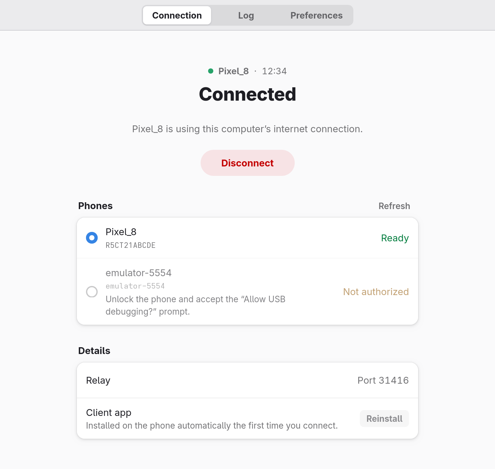
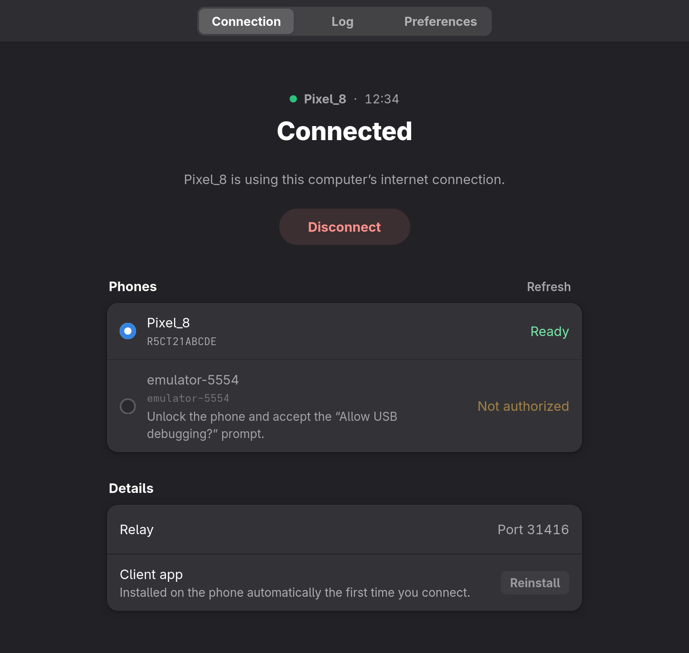

# Gnirehtet GUI

A desktop app for [gnirehtet](https://github.com/Genymobile/gnirehtet): share your
computer's internet connection with an Android phone over USB, without root and
without configuring anything on the phone.

Plug the phone in, click **Connect**, accept the VPN prompt on the phone, and it
is online. The app takes care of the parts of gnirehtet that usually happen in a
terminal: starting the relay, installing the Android client, setting up the adb
tunnel, and cleaning up when you disconnect or unplug.

<p align="center">
  
  &nbsp;
  
</p>

It uses the unmodified gnirehtet **v2.5.1** relay and Android client; this project
adds the desktop interface and the process management around them.

The upstream relay source is also vendored in `crates/gnirehtet-relay`, because
upstream ships no prebuilt relay for macOS or ARM. On those platforms the build
compiles it from that copy instead of downloading it.

## Features

- Detects connected phones and explains what to do when one is unauthorized,
  offline or not accessible (Linux udev permissions).
- Installs the gnirehtet client on the phone automatically on first use.
- Shows the connection state as it happens: starting, waiting for the phone's
  VPN prompt, connected, interrupted.
- Restores the USB tunnel automatically when the cable is plugged back in.
- Stops the VPN on the phone and the relay on the computer when you disconnect
  or quit.
- Optional DNS servers, routes and relay port; light and dark themes; a log view
  for troubleshooting.

## Install

Download the installer for your system from the
[Releases](https://github.com/sawongam/gnirehtet-gui/releases) page:

| System | File |
|--------|------|
| Debian, Ubuntu | `.deb` |
| Fedora, openSUSE | `.rpm` |
| Other Linux | `.AppImage` |
| Windows | `.msi` or `-setup.exe` |
| macOS | `.dmg` |

The app also needs **adb** (Android platform-tools). See the
[installation guide](docs/INSTALL.md) for step-by-step instructions for each
system and for preparing the phone.

## Usage

1. Enable **USB debugging** on the phone (Settings → About phone → tap *Build
   number* seven times, then Settings → Developer options → USB debugging).
2. Connect the phone with a USB cable and accept the *Allow USB debugging?*
   prompt on the phone.
3. Open Gnirehtet, select the phone and click **Connect**.
4. Accept the *Connection request* (VPN) prompt on the phone.

The phone now uses the computer's connection. Click **Disconnect** to stop.
If something goes wrong, see [Troubleshooting](docs/TROUBLESHOOTING.md).

## Limitations

These come from gnirehtet itself:

- IPv4 only: IPv6 traffic is not relayed.
- TCP and UDP only (no ICMP, so `ping` does not work on the phone).
- One phone at a time in this app.

## Building from source

```bash
git clone https://github.com/sawongam/gnirehtet-gui.git
cd gnirehtet-gui/apps/desktop
npm install
npm run setup        # fetches the pinned gnirehtet relay and APK (checksum-verified)
npm run tauri dev    # run in development
npm run tauri build  # build installers into target/release/bundle/
```

Prerequisites (Rust 1.88, Node.js 20.19+, system libraries) and the project layout
are described in the [development guide](docs/DEVELOPMENT.md).

## Documentation

- [Installation](docs/INSTALL.md)
- [Troubleshooting](docs/TROUBLESHOOTING.md)
- [Architecture](docs/ARCHITECTURE.md)
- [Development](docs/DEVELOPMENT.md)
- [Contributing](CONTRIBUTING.md)
- [Changelog](CHANGELOG.md)

## License

Apache License 2.0; see [LICENSE](LICENSE) and [NOTICE](NOTICE).

gnirehtet is developed by [Genymobile](https://github.com/Genymobile/gnirehtet)
and is also licensed under Apache 2.0. This project is not affiliated with
Genymobile.
